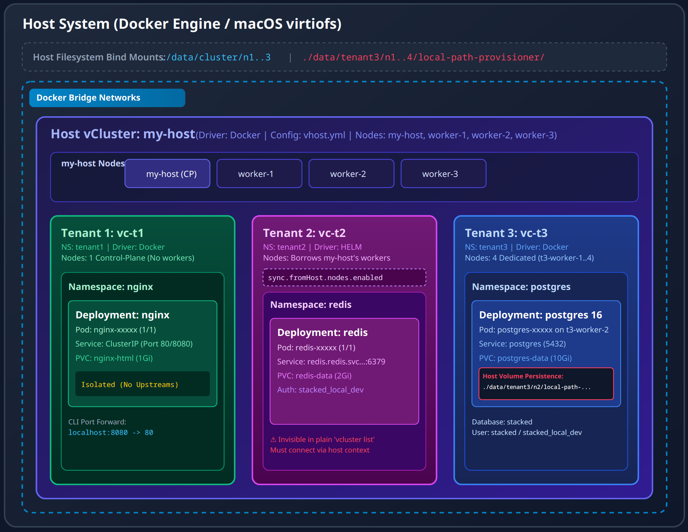
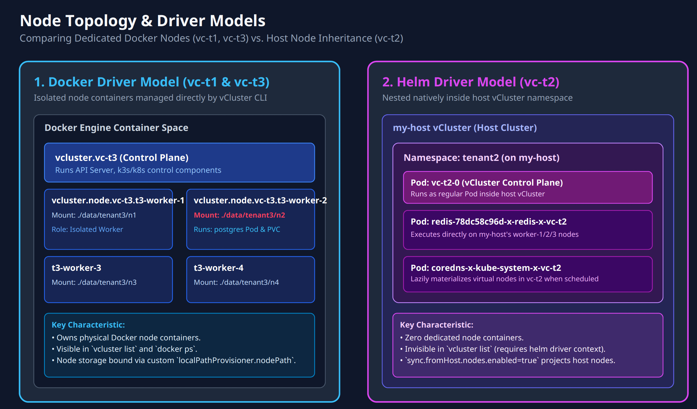
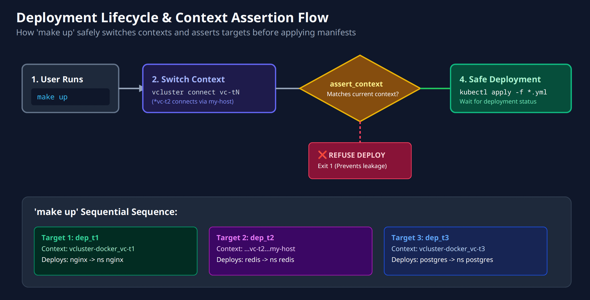
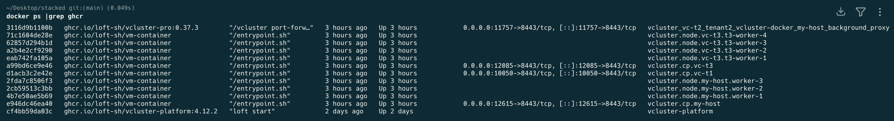

# Stacking Clusters — a Host vCluster plus three Tenant Clusters, all using vCluster

## Overview

So you got a laptop, you have Docker installed, and you want to run Kubernetes. The easy answer is vCluster using the vind pattern.

You write all your scripts. You go ask your manager for a larger cluster. You get told the department has this nice big cluster, but there are loads of developers working on it, and everyone is trying to make sure they don't bump into each other. All using tightly controlled/complex naming patterns for their services/deployments, pv, pvc's etc.

It's a mess... And we haven’t even tried to install some common utilities using Helm charts, that just to make your life more interesting need to deploy components into the "single" system namespace.

It's a Nightmare.

Well below is the light at the end of the tunnel. Each developer gets assigned a namespace and what we show below is he/she can be given their own Kubernetes cluster, hosted using vCluster inside their dedicated namespace. A full Kubernetes cluster with its own control plane.

Also makes for an amazing design to accommodate different phases of code testing by an internal test team, or even Blue/Green deployments.


## Our Lab

What we have below is a Docker engine, onto which we then create our host cluster using vCluster. Once we have that vCluster/host Kubernetes cluster we have the pattern as described above. The host cluster above can be AWS Elastic Kubernetes Service (EKS), Google Container Platform (GCP), Azure Kubernetes Service (AKS), Redhat Openshift, Rancher.


I've created three tenant clusters, patterns, using the different deployment options, from the simplest to one a bit more defined, more granular control, which someone might read as complicated, but if you look at it you will quickly see the power it gives you.

## Our build

A self-contained local lab: one host vCluster (`my-host`) and three tenant clusters (`vc-t1`, `vc-t2`, `vc-t3`), each running one service.

| Tenant | Cluster | Driver     | Config     | Nodes                               | Service  | Namespace |
| :-- | :-- | :-- | :-- | :-- | :-- | :-- |
| t1 | `vc-t1` | docker (default) | —        | 1 control-plane node, no workers    | nginx    | `nginx`   |
| t2 | `vc-t2` | **helm**         | `t2.yml` | borrows `my-host`'s `worker-1/2/3`  | redis    | `redis`   |
| t3 | `vc-t3` | docker           | `t3.yml` | 4 own nodes `t3-worker-1..4`        | postgres | `postgres`|

**The three tenants are three independent Kubernetes clusters.** There is no cross-cluster DNS: `redis.redis.svc.cluster.local` resolves inside `vc-t2` and nowhere else. Nothing here talks to anything else on purpose — see [Why nginx has no upstreams](#why-nginx-has-no-upstreams).

```
vcluster 0.37.3 · k8s v1.36.0 · Docker Desktop / virtiofs

my-host (docker driver, vhost.yml)
├── worker-1   ── ./data/cluster/n1
├── worker-2   ── ./data/cluster/n2
├── worker-3   ── ./data/cluster/n3
│
├── tenant1 / vc-t1  (docker driver, no -f)
│   └── nginx        1 node, no workers
│
├── tenant2 / vc-t2  (HELM driver, t2.yml)  ── no nodes of its own
│   └── redis        runs on my-host's worker-N
│
└── tenant3 / vc-t3  (docker driver, t3.yml)
    ├── t3-worker-1  ── ./data/tenant3/n1
    ├── t3-worker-2  ── ./data/tenant3/n2 ── ./data/tenant3/n2/local-path-provisioner/ ← postgres PV
    ├── t3-worker-3  ── ./data/tenant3/n3
    └── t3-worker-4  ── ./data/tenant3/n4
```

### Diagram 1: High-Level Architecture Overview

This diagram shows the complete hierarchy from the host OS / Docker Engine down through the my-host vCluster, the 3 tenant clusters, and their deployed applications.



### Diagram 2: Driver & Node Scheduling Models

This diagram details the core differences between Docker-driver vClusters (vc-t1 and vc-t3), which spin up dedicated node containers, versus the Helm-driver vCluster (vc-t2), which embeds workloads into my-host's worker nodes.



### Diagram 3: Deployment Lifecycle & Context Routing Workflow

This diagram visualizes the context assertion and execution flow enforced by your Makefile to prevent cross-tenant deployment errors (such as deploying Redis into vc-t1).



### Summary of Architectural Highlights Captured

1. Isolation & Non-Connectivity: Each tenant lives in its own Kubernetes cluster with completely independent DNS zones (e.g., redis.redis.svc.cluster.local only resolves within vc-t2).

2. Helm Driver Nuance (vc-t2): Operates inside my-host's namespaces and executes on my-host's physical worker nodes (worker-1..3), requiring host-context routing.

3. Storage Mapping (vc-t3): Configured with deploy.localPathProvisioner.nodePath: /data/local-path-provisioner, mapping persistent volume claims directly to host paths (./data/tenant3/n2/local-path-provisioner/...).


---

## Quick start

```bash
make host        # host vCluster + tenant1/2/3 namespaces
make cr_t1       # nginx    -> vc-t1
make cr_t2       # redis    -> vc-t2   (helm driver)
make cr_t3       # postgres -> vc-t3
make up          # all three services in one shot (switches context itself)

make down        # tenants first, then host, then volumes — nothing leaks
```

---

## The three node patterns

### t1 — plain default

```bash
vcluster create vc-t1 -n tenant1
```

No config file. The control plane gets one node and no workers; it is the
smallest thing that runs.

### t2 — inherits `my-host`'s nodes (helm driver)

```bash
vcluster connect my-host
vcluster create vc-t2 -n tenant2 --driver helm -f t2.yml
```

This is the "Kubernetes-native" pattern: the control plane installs as ordinary
Pods **into** `my-host` and runs workloads on `my-host`'s real nodes. `vc-t2`
owns no node containers at all.

#### ⚠ `--driver helm` is not optional, and this file changed shape

Two traps, both hit while building this lab:

**1. The old `sync.nodes` block no longer exists.** Earlier revisions of
`t2.yml` were:

```yaml
sync:
  nodes:
    enabled: true
    syncAllNodes: true
```

On 0.37.x that is a **hard startup failure**, not a warning — the chart schema
sets `additionalProperties: false`, so the unknown key makes the control plane
crash-loop:

```
sync and load vCluster config: error unmarshaling JSON:
while decoding JSON: json: unknown field "nodes"
```

Node syncing still exists; it moved under the host→vCluster direction, and
`syncAllNodes` was dropped. The 0.37.x equivalent is in `t2.yml`:

```yaml
sync:
  fromHost:
    nodes:
      enabled: true
      syncBackChanges: false   # left off: see below
```

`syncBackChanges` is deliberately **off**. Enabling it lets anyone inside the
tenant relabel or taint `my-host`'s actual worker nodes — a real privilege
escalation path out of the tenant boundary.

**2. `vcluster list` does not show helm-driver clusters.** `vc-t2` is invisible
to the docker-driver view. Consequences, all handled in the Makefile:

- `switch_t2` must run `vcluster connect vc-t2 -n tenant2 --driver helm`, and
  must be issued **while pointed at `my-host`** — the helm driver resolves the
  cluster by querying the current kube context. Connecting from `vc-t1`'s
  context fails with `couldn't find vcluster vc-t2` and leaves the old context
  active, which is how redis once got deployed into `vc-t1` while the log
  cheerfully said "on tenant cluster vc-t2".
- `make down` cannot find `vc-t2` in `vcluster list` either. It detects the Helm
  release secret `sh.helm.release.v1.vc-t2.v1` in the host namespace instead.

#### Nodes appear lazily

Because `sync.fromHost.nodes` only materialises a virtual node for host nodes
that actually host a synced pod, `kubectl get nodes` inside `vc-t2` **changes
over time**. Two runs of this same lab:

```bash
make switch_t2 && kubectl get nodes
```

Immediately after creation — only the node running the vCluster's own coredns:

```
NAME       STATUS   ROLES    AGE   VERSION
worker-1   Ready    <none>   6s    v1.36.0
```

Later, after a workload was scheduled and landed on `worker-2`:

```
NAME       STATUS   ROLES    AGE     VERSION
worker-2   Ready    <none>   49m     v1.36.0
worker-3   Ready    <none>   51m     v1.36.0
```

Note the node *set* is not fixed, and `worker-1` may be absent entirely. The
syncer log line that explains it:

```
node.worker-1  syncer/wrapper.go:26  create virtual node worker-1, because there is a virtual pod with that node
```

### t3 — four dedicated nodes, storage on the host

```bash
vcluster create vc-t3 -n tenant3 -f t3.yml
```

Four own node containers, each bind-mounting `./data/tenant3/nN` to `/data`.

#### Getting PV data onto the host filesystem

The bind mounts above land at `/data` inside each node container, but **nothing
writes there by default**. The local-path provisioner creates its volume
directories at:

```
/opt/local-path-provisioner/pvc-<uuid>_<ns>_<claim>
```

…which sits on the node container's own **overlay filesystem** — inside Docker's
storage on the macOS VM. Verified before the fix:

```bash
docker exec vcluster.node.vc-t3.t3-worker-2 \
  find / -maxdepth 7 -type d -name 'pvc-*'
```

```
/opt/local-path-provisioner/pvc-52129cd3-..._postgres_postgres-data
```

Nothing under `./data`, and `make down` does **not** remove it.

`t3.yml` fixes this with one block:

```yaml
deploy:
  localPathProvisioner:
    nodePath: /data/local-path-provisioner
```

A volume claimed by `t3-worker-2` is now visible on the host at:

```
./data/tenant3/n2/local-path-provisioner/pvc-<uuid>_postgres_postgres-data/pgdata
```

with real PostgreSQL files in it:

```bash
cat data/tenant3/n*/local-path-provisioner/*/pgdata/PG_VERSION
```

```
16
```

Knock-on effects worth knowing:

- `make down` (`rm -rf ./data/tenant3`) discards the database.
- The path is **per-node**, so a PVC pinned to `t3-worker-2` is only ever a
  subdirectory of `./data/tenant3/n2`. Never hardcode `n1` in a script.
- `/data` is a virtiofs mount on macOS Docker Desktop — handy for inspection,
  not a production storage backend.

---

## Deploy Example

Captured from a clean `make down` → `make host` → tenants → `make up` run on
vCluster 0.37.3 / k8s v1.36.0. Timestamps and spinner frames are from that run;
`kubectl` listings are from the resulting live lab, so ages differ.

### Host

```bash
make host
```

```
🚀 [1/2] Creating persistent store directory
🚀 [2/2] Creating host vcluster my-host
13:26:04 info Using vCluster driver 'docker' to create your virtual clusters, which means the CLI is managing Docker-based virtual clusters locally
13:26:04 info Ensuring environment for vCluster my-host...
13:26:04 done Created network vcluster.my-host
13:26:08 warn Load balancer type services are not supported inside the vCluster because this command was executed with insufficient privileges. To enable load balancer type services, run this command with sudo
13:26:10 info Starting vCluster standalone my-host
13:26:17 info Waiting for vCluster standalone node to be joined...
13:26:38 done vCluster standalone node joined successfully
13:26:38 info Adding node worker-1 to vCluster my-host
13:26:38 info Joining node vcluster.node.my-host.worker-1 to vCluster my-host...
13:26:45 info Adding node worker-2 to vCluster my-host
13:26:46 info Joining node vcluster.node.my-host.worker-2 to vCluster my-host...
13:26:50 info Adding node worker-3 to vCluster my-host
13:26:51 info Joining node vcluster.node.my-host.worker-3 to vCluster my-host...
13:26:56 done Successfully created virtual cluster my-host
13:26:56 done Switched active kube context to vcluster-docker_my-host
  ⏳ Settling host...
🚀 Creating tenant namespaces in host
namespace/tenant1 created
namespace/tenant2 created
namespace/tenant3 created

✅ Host Cluster Up
   Next: make cr_t1
   Next: make cr_t2
   Next: make cr_t3
```

```bash
kubectl get namespaces
```

```
NAME                 STATUS   AGE
default              Active   53m
kube-flannel         Active   52m
kube-node-lease      Active   53m
kube-public          Active   53m
kube-system          Active   53m
local-path-storage   Active   52m
tenant1              Active   52m
tenant2              Active   52m
tenant3              Active   52m
```

```bash
kubectl get nodes
```

```
NAME       STATUS   ROLES                  AGE   VERSION
my-host    Ready    control-plane,master   52m   v1.36.0
worker-1   Ready    <none>                 52m   v1.36.0
worker-2   Ready    <none>                 52m   v1.36.0
worker-3   Ready    <none>                 52m   v1.36.0
```

### Tenant 1 — nginx (plain `vcluster create`)

```bash
make cr_t1
```

```
🚀 Provisioning tenant cluster vc-t1 in namespace tenant1 (Default Docker Driver)
13:27:03 done Created network vcluster.vc-t1
13:27:32 done vCluster standalone node joined successfully
13:27:32 done Successfully created virtual cluster vc-t1
13:27:32 done Switched active kube context to vcluster-docker_vc-t1

No resources found in tenant1 namespace.
```

One node, no workers — the nginx pod runs here:

```bash
make switch_t1 && kubectl get nodes
```

```
NAME    STATUS   ROLES                  AGE   VERSION
vc-t1   Ready    control-plane,master   52m   v1.36.0
```

### Tenant 2 — redis (helm driver, inherits host nodes)

```bash
make cr_t2
```

`cr_t2` switches to the host first; that prerequisite is what stops it nesting
inside `vc-t1` by accident.

```
13:27:34 done Switched active kube context to vcluster-docker_my-host
NAME                 STATUS   AGE
default              Active   75s
kube-flannel         Active   60s
kube-node-lease      Active   75s
kube-public          Active   75s
kube-system          Active   75s
local-path-storage   Active   60s
tenant1              Active   33s
tenant2              Active   33s
tenant3              Active   33s
🚀 Provisioning tenant cluster vc-t2 in namespace tenant2 (Helm Driver — inherits my-host nodes)
13:27:40 done Successfully created virtual cluster vc-t2 in namespace tenant2
13:28:32 done vCluster is up and running
13:28:33 done Switched active kube context to vcluster_vc-t2_tenant2_vcluster-docker_my-host

No resources found in tenant2 namespace.
```

Note there are no "Adding node" lines — `vc-t2` owns no node containers, it is
Pods inside `my-host`:

```bash
kubectl -n tenant2 get pods          # from the HOST context
```

```
NAME                                              READY   STATUS    RESTARTS   AGE
coredns-df8c87f55-kvlt2-x-kube-system-x-vc-t2     1/1     Running   0          51m
redis-78dc58c96d-2wwjd-x-redis-x-vc-t2            1/1     Running   0          49m
vc-t2-0                                           1/1     Running   0          52m
```

And `vcluster list` does not show it:

```bash
vcluster list
```

```
  
     NAME   | STATUS  | CONNECTED | AGE  
  ----------+---------+-----------+------
    vc-t3   | running |           | 50m  
    vc-t1   | running |           | 52m  
    my-host | running | True      | 53m  
  
```

### Tenant 3 — postgres (docker driver, 4 nodes)

```bash
make cr_t3
```

```
🚀 Provisioning tenant cluster vc-t3 in namespace tenant3 (Docker Driver — 4 own worker nodes)
13:28:36 done Created network vcluster.vc-t3
13:28:43 info Waiting for vCluster standalone node to be joined...
13:29:04 done vCluster standalone node joined successfully
13:29:04 info Adding node t3-worker-1 to vCluster vc-t3
13:29:04 info Joining node vcluster.node.vc-t3.t3-worker-1 to vCluster vc-t3...
13:29:11 info Adding node t3-worker-2 to vCluster vc-t3
13:29:12 info Joining node vcluster.node.vc-t3.t3-worker-2 to vCluster vc-t3...
13:29:16 info Adding node t3-worker-3 to vCluster vc-t3
13:29:17 info Joining node vcluster.node.vc-t3.t3-worker-3 to vCluster vc-t3...
13:29:21 info Adding node t3-worker-4 to vCluster vc-t3
13:29:22 info Joining node vcluster.node.vc-t3.t3-worker-4 to vCluster vc-t3...
13:29:26 done Successfully created virtual cluster vc-t3
13:29:26 done Switched active kube context to vcluster-docker_vc-t3

No resources found in tenant3 namespace.
```

```bash
make switch_t3 && kubectl get nodes
```

```
NAME          STATUS   ROLES                  AGE   VERSION
t3-worker-1   Ready    <none>                 50m   v1.36.0
t3-worker-2   Ready    <none>                 50m   v1.36.0
t3-worker-3   Ready    <none>                 50m   v1.36.0
t3-worker-4   Ready    <none>                 50m   v1.36.0
vc-t3         Ready    control-plane,master   50m   v1.36.0
```

Host directory layout, now that `t3.yml` sets `nodePath`:

```bash
find data -maxdepth 3 -type d | sort
```

```
data
data/cluster
data/cluster/n1
data/cluster/n2
data/cluster/n3
data/tenant3
data/tenant3/n1
data/tenant3/n2
data/tenant3/n2/local-path-provisioner
data/tenant3/n3
data/tenant3/n4
```

### All three services

```bash
make up
```

`up` switches context itself — one kube context cannot address three clusters at
once — and each target asserts the context before writing:

```
  ✓ context vcluster-docker_vc-t1
🚀 Deploying nginx -> ns nginx on tenant cluster vc-t1
namespace/nginx created
serviceaccount/nginx created
configmap/nginx-conf created
persistentvolumeclaim/nginx-html created
deployment.apps/nginx created
service/nginx created
  ⏳ waiting for deploy/nginx
deployment.apps/nginx condition met
  ✅ nginx: kubectl -n nginx port-forward svc/nginx 8080:80

  ✓ context vcluster_vc-t2_tenant2_vcluster-docker_my-host
🚀 Deploying redis -> ns redis on tenant cluster vc-t2
namespace/redis created
serviceaccount/redis created
secret/redis-auth created
configmap/redis-conf created
persistentvolumeclaim/redis-data created
deployment.apps/redis created
service/redis created
  ⏳ waiting for deploy/redis
deployment.apps/redis condition met
  ✅ redis: redis.redis.svc.cluster.local:6379 (inside vc-t2 only)

  ✓ context vcluster-docker_vc-t3
🚀 Deploying postgres 16 -> ns postgres on tenant cluster vc-t3
namespace/postgres created
serviceaccount/postgres created
secret/postgres-auth created
configmap/postgres-conf created
persistentvolumeclaim/postgres-data created
deployment.apps/postgres created
service/postgres created
service/postgres-headless created
  ⏳ waiting for deploy/postgres
deployment.apps/postgres condition met
  ✅ postgres: postgres.postgres.svc.cluster.local:5432 (stacked/stacked_local_dev)
  ✅ PV on host: ./data/tenant3/n<N>/local-path-provisioner/

✅ All three tenant services up
   vc-t1 / ns nginx     http://nginx.nginx.svc.cluster.local:80
   vc-t2 / ns redis     redis.redis.svc.cluster.local:6379
   vc-t3 / ns postgres  postgres.postgres.svc.cluster.local:5432  (stacked/stacked_local_dev)

   Each name resolves ONLY inside its own cluster — they do not talk to each other.
   Active context is now vc-t3; use 'make switch_tN' to change.
```

If you skip `make switch_tN`, the deploy refuses instead of guessing:

```
✗ refusing to deploy: active context is 'vcluster-docker_vc-t1', expected one containing 'vc-t3'.
  Run 'make switch_t3' first.
```

### Verification

```bash
make switch_t1
kubectl -n nginx get pods
```

```
NAME                     READY   STATUS    RESTARTS   AGE
nginx-5dcdd66f6d-n62pf   1/1     Running   0          50m
```

```bash
kubectl -n nginx port-forward svc/nginx 8080:80 &
curl -s http://127.0.0.1:8080/nginx-health
nginx ok
curl -s http://127.0.0.1:8080/cluster-info
{"tenant":"vc-t1","namespace":"nginx","role":"edge"}
```

```bash
make switch_t2
kubectl -n redis get pods
```

```
NAME                     READY   STATUS    RESTARTS   AGE
redis-78dc58c96d-2wwjd   1/1     Running   0          49m
```

```bash
kubectl -n redis exec deploy/redis -- redis-cli -a stacked_local_dev PING
PONG
kubectl -n redis exec deploy/redis -- redis-cli PING          # no auth
NOAUTH Authentication required.
```

```bash
make switch_t3
kubectl -n postgres get pods -o wide
```

```
NAME                        READY   STATUS    RESTARTS   AGE   IP           NODE          NOMINATED NODE   READINESS GATES
postgres-6d95cb7f7f-6h7lt   1/1     Running   0          49m   10.244.3.3   t3-worker-2   <none>           <none>
```

```bash
kubectl -n postgres exec deploy/postgres -- psql -U stacked -tAc 'SHOW server_version'
16.15
```

### Persistence

Delete the pod and let the Deployment replace it — the PVC stays:

```bash
kubectl -n postgres exec deploy/postgres -- psql -U stacked -d stacked \
  -c "CREATE TABLE e2e(id serial primary key, note text); INSERT INTO e2e(note) VALUES ('survives-restart');"
```

```
CREATE TABLE
INSERT 0 1
```

```bash
kubectl -n postgres delete pod -l app.kubernetes.io/name=postgres --wait=false
pod "postgres-6d95cb7f7f-c92dh" deleted from postgres namespace
kubectl -n postgres get pods
```

```
NAME                        READY   STATUS    RESTARTS   AGE
postgres-6d95cb7f7f-jgqp6   1/1     Running   0          9s
```

```bash
kubectl -n postgres exec deploy/postgres -- psql -U stacked -tAc "SELECT note FROM e2e"
```

```
ROW SURVIVED: survives-restart
```

Same check for redis:

```bash
kubectl -n redis exec deploy/redis -- redis-cli -a stacked_local_dev SET e2e:key "hello-from-vc-t2"
OK
kubectl -n redis delete pod -l app.kubernetes.io/name=redis --wait=false
kubectl -n redis exec deploy/redis -- redis-cli -a stacked_local_dev GET e2e:key
"hello-from-vc-t2"
```

And the data really is on the host, not in a Docker layer:

```bash
kubectl -n postgres get pvc --no-headers
```

```
postgres-data   Bound   pvc-f6ab58e2-758d-401c-b1c2-56aba66a4a3b   10Gi   RWO   local-path   <unset>   49m
```

```bash
du -sh data/tenant3/n2/local-path-provisioner/*/
```

```
 46M	data/tenant3/n2/local-path-provisioner/pvc-f6ab58e2-758d-401c-b1c2-56aba66a4a3b_postgres_postgres-data/
```

### All Docker Containers



### Teardown

```bash
make down
```

```
🛑 Deleting tenant cluster vc-t3 (ns tenant3, docker driver)
  ✓ vc-t3 deleted
🛑 Deleting tenant cluster vc-t2 (ns tenant2, helm driver)
  ✓ vc-t2 deleted
🛑 Deleting tenant cluster vc-t1 (ns tenant1, docker driver)
  ✓ vc-t1 deleted
🛑 Deleting host vcluster my-host
  ✓ my-host deleted
🛑 Removing node volumes
  ✓ ./data removed
✅ Cluster torn down
```

Nothing left behind:

```bash
vcluster list
```

```
  
    NAME | STATUS | CONNECTED | AGE  
  ------+--------+-----------+------
  
```

```bash
docker ps -a --filter name=vcluster --format '{{.Names}}'
```

```
vcluster-platform
```

```bash
find data
```

```
data
```

`vcluster-platform` is the vCluster platform sync container, not part of this
lab. `./data` is empty because `make down` removed the node volumes — and, since
`nodePath` is set, that now really does include the postgres data.

---

## Why nginx has no upstreams

An earlier `nginx.yml` proxied `/redis-health` and `/pg-health` at
`redis.redis.svc.cluster.local` and `postgres.postgres.svc.cluster.local`. That
**cannot work**: those names live in `vc-t2`'s and `vc-t3`'s DNS domains, and
nginx is on `vc-t1`. nginx resolves a literal upstream hostname during startup,
so it hard-exits:

```
nginx: [emerg] host not found in upstream "redis.redis.svc.cluster.local"
```

`nginx.yml` is now self-contained. To actually front redis or postgres you need
one of:

- put nginx on the same cluster as the backend,
- an ingress/controller that spans clusters, or
- rewrite the upstreams to routable addresses (NodePort/LB IP, **not** `.svc`
  DNS) and add a `resolver` so nginx does not need them at startup.

---

## Credentials

| Service   | Where              | Credentials                                                                 |
| :-- | :-- | :-- |
| redis     | `vc-t2` / ns `redis`    | password `stacked_local_dev` (Secret `redis-auth`)                     |
| postgres  | `vc-t3` / ns `postgres` | user `stacked`, password `stacked_local_dev`, db `stacked` (Secret `postgres-auth`, which also carries a ready-made `DATABASE_URL`)                                               |

> An **empty** `requirepass` is not "open but authenticated" — redis treats
> `--requirepass ""` as auth disabled entirely, and every `AUTH` then fails with
> `ERR AUTH <password> called without any password configured`, which also
> spams the probes. Set a real value.

Local lab credentials only; do not carry this pattern to anything shared.

---

## Files

| File        | Purpose                                                            |
| :-- | :-- |
| `vhost.yml` | `my-host` — control plane + 3 workers, volumes in `./data/cluster` |
| `t2.yml`    | `vc-t2` — helm driver, `sync.fromHost.nodes`                       |
| `t3.yml`    | `vc-t3` — docker driver, 4 nodes, `localPathProvisioner.nodePath`  |
| `nginx.yml` | nginx → `vc-t1` / ns `nginx`                                       |
| `redis.yml` | redis → `vc-t2` / ns `redis`                                       |
| `pg.yml`    | postgres 16 → `vc-t3` / ns `postgres`                              |
| `Makefile`  | host / tenant lifecycle, context switching, deploy, teardown       |

---

*End of Document*
